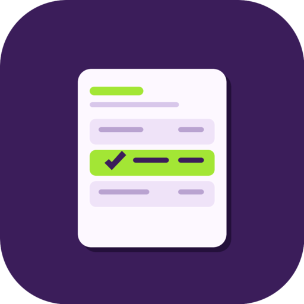

# Client Proposal Agent

A SKILL.md skill that turns a messy brief and a rate card into a client-ready proposal: the problem in their words, an honest scope, three priced options, a realistic timeline, and the internal notes you need for the call.

Most proposal tools generate adjectives. This one generates a decision.

## What it does

1. Asks only what is missing — brief, rates, deadline
2. Diagnoses the real problem and the measurable outcome
3. Writes inclusions **and** exclusions, so scope creep has nowhere to hide
4. Builds Essential / Recommended / Premium from your rate card — never invented prices
5. Adds timeline, payment schedule, terms, and a validity window
6. Writes internal objection notes for price, timeline, and DIY
7. Self-reviews: numbers consistent, dates real, no placeholder left

## The three-option structure

| Tier | Role | What changes |
| --- | --- | --- |
| Essential | The smallest scope that still solves the core problem | Fewer pages/features, standard pace |
| Recommended | The option you want chosen | The pieces that make the outcome likely |
| Premium | No compromise | Speed, support, or strategic depth |

Same quality bar across tiers — the difference is depth, speed, and extras, not sabotage.

## What's inside

```text
client-proposal-agent/
├── SKILL.md
├── references/
│   └── pricing-and-scoping.md    # option mechanics, anchors, scoping traps, discovery questions
├── templates/
│   └── proposal-outline.md       # section skeleton with word budgets
└── examples/
    └── worked-example.md         # gym website brief → full proposal with three prices
```

## Who it's for

- Freelancers quoting projects
- Agencies writing SOWs and proposals
- Anyone answering an RFP without a template

## Honesty rules baked in

- No invented rates, discounts, case studies, testimonials, or client logos
- No guaranteed revenue or ranking claims
- No scope you cannot deliver in the stated timeline
- No fake urgency

## Get it

- **Agensi:** _listing link after publication_
- **Local:** copy `client-proposal-agent/` into your agent's skills directory (Claude Code: `~/.claude/skills/client-proposal-agent/`). Folder name must match the frontmatter `name`.

## License

MIT
